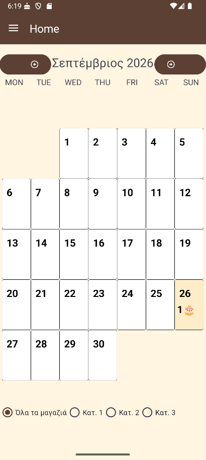
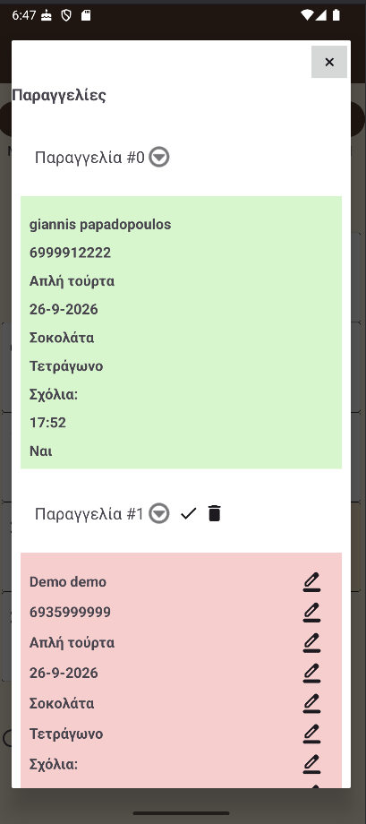
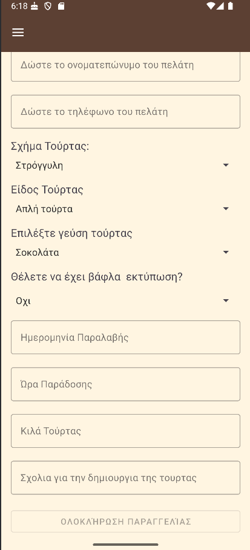
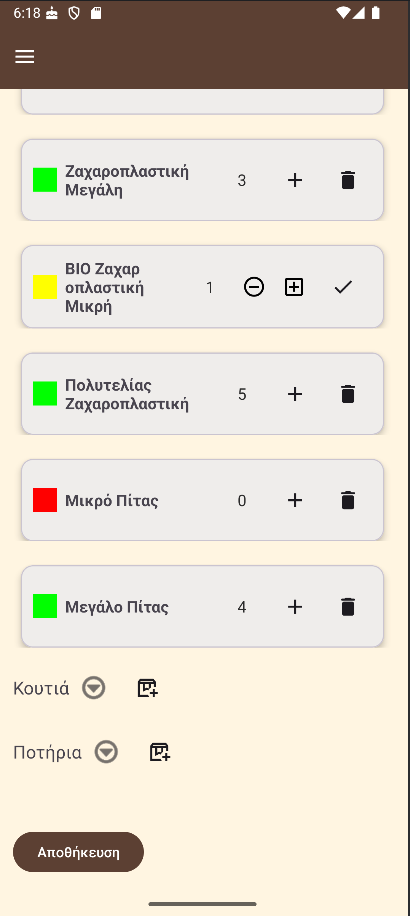
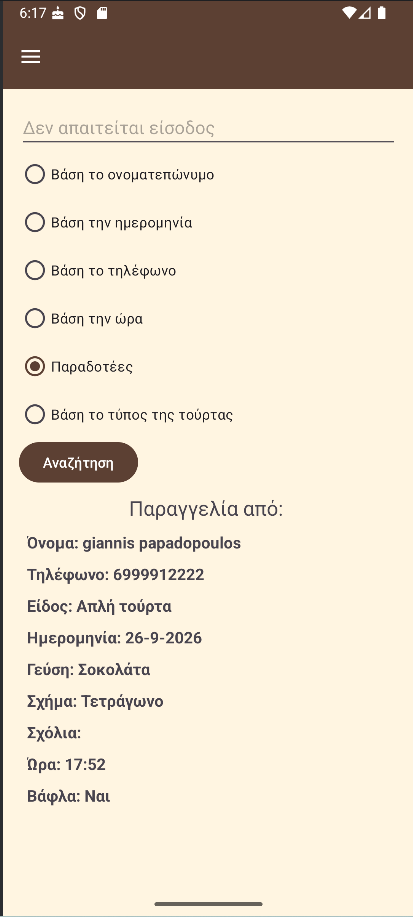
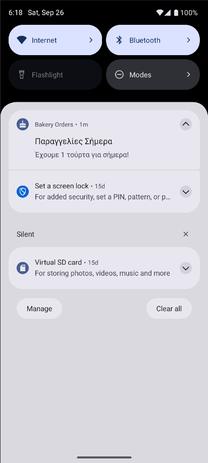

# Bakery Orders

An Android app for a bakery that takes cake orders across several shops. Orders are placed on a
form, appear on a month calendar, and can be edited, marked as prepared or deleted from the day
they belong to. A second screen keeps the stock of packaging (bags, boxes, cups) per shop, and a
third one searches past orders by name, phone, date, time or cake type.

Every order lives in Cloud Firestore, so all shops see the same data, and is mirrored in a local
Room database that keeps the app usable and fast. A background worker checks each day's orders and
raises a notification.

## Screenshots

| Calendar | Orders of the day | New order |
|---|---|---|
|  |  |  |

| Packaging stock | Search | Daily notification |
|---|---|---|
|  |  |  |

## Features

- Month calendar showing how many cakes are due on each day, per shop or for all shops at once
- Order form with cake shape, type, flavour, wafer print, delivery date and time, weight and notes
- Nine inline edits on an existing order, each written to both databases at once
- An order can be marked as prepared, which locks it and colours it green, or deleted with
  confirmation
- Packaging stock per shop with a colour indicator: green for enough, yellow for low, red for out
- Search past orders by customer name, phone, date, time or cake type
- Daily notification with the number of cakes due today
- Live updates: a Firestore snapshot listener refreshes the calendar as soon as another shop
  changes something
- Anonymous Firebase Authentication, with Firestore rules that only allow signed-in clients, so
  the database is not open to anyone holding the configuration file
- Shop isolation: each installation belongs to one shop (currently `Shop1`, set in code) and can
  only edit, complete or delete its own orders. Orders from the other shops are visible in
  read-only form, so no shop can modify or delete another shop's cakes

## Tech stack

Kotlin · Android SDK 24-35 · Room · Cloud Firestore · Firebase Auth · WorkManager · ViewModel and
LiveData · Navigation Component · View Binding · Material Components · Gradle with version catalog

## Architecture

```
ui/home           calendar, order list, order editing, background worker
ui/gallery        the cake order form and its repository
ui/Product_Item   packaging stock, with one package per item type
ui/info           search over past orders
```
Write access is scoped by shop: the adapter receives the shop it belongs to, hides every editing
control when the order comes from another shop, and the repository builds the Firestore path from
that same value. A shop therefore cannot write outside its own branch of the database.

Each screen follows the same path: Fragment → ViewModel → Repository → DAO or Firestore. The
`OrderRepository` is the single place where an order is written, so the adapters only render data
and never touch a database.

### Local database (Room)

| Table | Purpose |
|---|---|
| `products` | Packaging types: bags, boxes, cups, with the total quantity |
| `bag`, `box`, `cup` | Individual packaging items, each with a foreign key to `products` and cascade on update and delete |
| `cakeOrder` | The cake orders, mirrored from Firestore |

### Remote database (Cloud Firestore)

```
CakeOrders/{shop}/CakeOrders/{orderId}
ProductStack/{shop}/BAGS/{id}
ProductStack/{shop}/BOXS/{id}
ProductStack/{shop}/CUPS/{id}
```

An order document holds `NameAndLastName`, `Tilefono`, `Eidos`, `Geusi`, `Sxima`, `Vafla`, `Day`,
`Time`, `Kila`, `Sxolia` and `IsChecked`.

## Running the app

The Firebase configuration is not part of this repository, so you need your own project.

1. Create a project at https://console.firebase.google.com and enable Cloud Firestore.
2. Add an Android app with the application id `com.example.myapplicationtest` (see the note below).
3. Download `google-services.json` and put it in `app/`.
4. Create at least one shop document under `CakeOrders`, for example `Shop1`, and a matching one
   under `ProductStack`. The app expects `Shop1`, `Shop2` and `Shop3`.
5. Open the project in Android Studio and run it on a device with Android 7.0 or newer.

The Room database is created on first launch and needs no setup.

**Note on the application id.** The Kotlin package was renamed to `com.fotis.bakeryorders`, but the
`applicationId` was deliberately left as `com.example.myapplicationtest` so that the existing
Firebase registration keeps working. In a fresh project both would be the same.

## Known limitations

- Room migrations are not implemented; the schema version has been raised during development
  without migration paths
- The foreign key columns in `bag`, `box` and `cup` are not indexed, which Room warns about at
  build time
- Error messages from Firestore are shown as toasts and, in a few places, only logged
- Authentication is anonymous, so every device is trusted once signed in. Per-user or per-shop
  permissions would require real accounts and finer-grained Firestore rules
- The shop each installation belongs to is a constant in the code, so a different build is needed
  per shop. A per-device setting or a shop login would be the next step

## Author

University project, developed in Kotlin for Android.

- **[Fotis Singiridis](https://github.com/Fotis28)**

## License

Copyright (c) 2026 Fotis Singiridis. All rights reserved.

This code is published for portfolio purposes: you are welcome to read it and run it locally,
but it may not be reused, redistributed or used commercially without permission.
See [LICENSE](LICENSE).